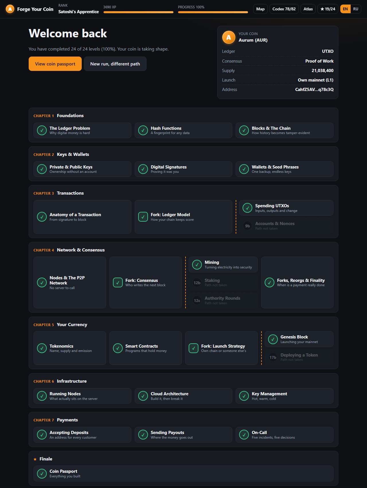
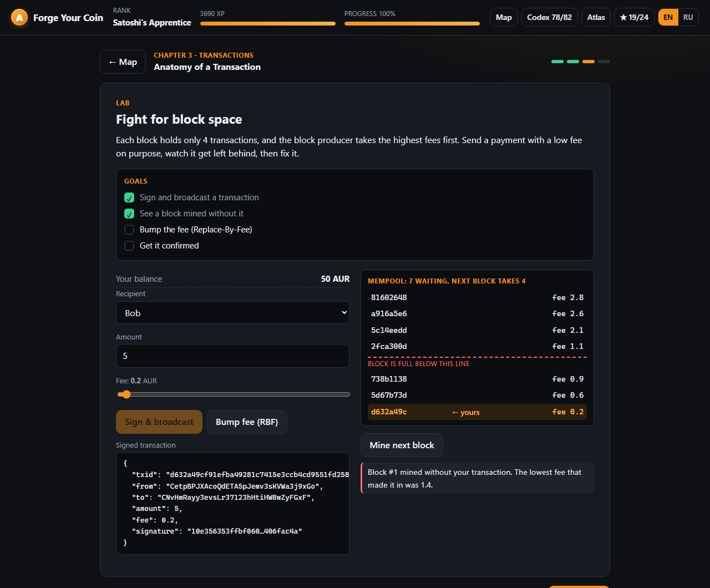
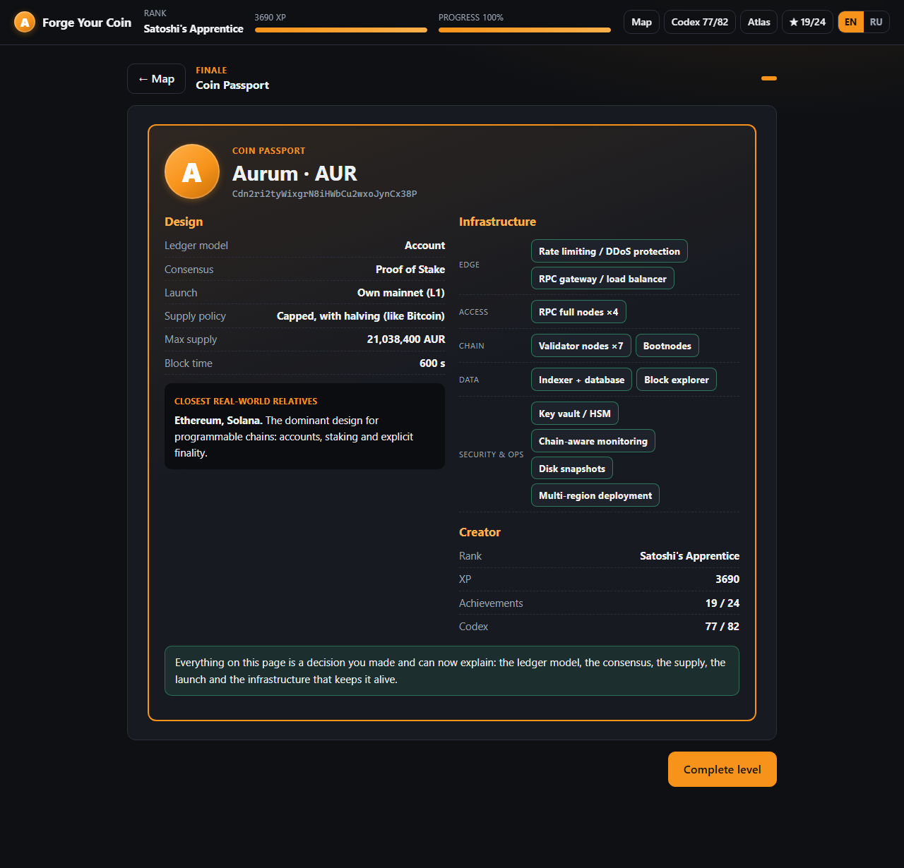

# Forge Your Coin

**Learn how blockchains and cryptocurrencies really work by building your own currency, from the first hash to accepting payments.**

Forge Your Coin is a browser game for people who have never touched crypto. It replaces passive reading with doing: every concept is introduced in a few short paragraphs and is immediately followed by a hands-on lab where the real thing is computed in front of you.

No installation, no build step, no server, no account. Download the folder and open `index.html`.



## What you do in the game

You start with an empty ledger and finish with a designed, launched and operated currency.

| Chapter | You learn | You do |
|---|---|---|
| 1. Foundations | Ledger, double-spend, hash, block, chain | Hash text live, tamper with a chain and pay to repair it |
| 2. Keys & Wallets | Private and public keys, addresses, signatures, seed phrases | Generate a real key pair, sign a message, try to forge it, restore a wallet from paper |
| 3. Transactions | Fees, mempool, Replace-By-Fee, UTXO vs account model | Get a transaction stuck and rescue it, build inputs and change, or fight nonce gaps |
| 4. Network & Consensus | Nodes, gossip, PoW, PoS, PoA, forks, reorgs, finality | Mine real blocks, stake and get slashed, halt a BFT network, run a 51% attack simulation |
| 5. Your Currency | Tokenomics, smart contracts, gas, tokens, stablecoins | Design the supply curve, call a contract until it reverts and runs out of gas, launch a mainnet or deploy a token |
| 6. Infrastructure | Node types, RPC, indexers, cloud architecture, HSM, multisig, MPC | Assemble a cloud architecture and run chaos tests against it, split a treasury into hot, warm and cold |
| 7. Payments | Deposit addresses, xpub, confirmations, payouts, batching, incidents | Issue addresses from a public key only, survive a chain reorg, make five on-call decisions |
| Finale | | Receive a passport of your coin: its design, its architecture and its closest real-world relatives |



## Your choices change the path

Three design decisions fork the game. Each one unlocks different levels and changes later theory, the infrastructure you have to build and the final passport.

```
Ledger model      UTXO ─────────────── or ─── Account
Consensus         Proof of Work ── Proof of Stake ── Proof of Authority
Launch strategy   Own mainnet (L1) ─── or ─── Token on a host chain
```

That is twelve distinct paths. After finishing, you can start a new run and take the forks you skipped; achievements and the glossary carry over.

## Game mechanics

- **Level map** of all 24 levels, visible from the start, with the branches you have not taken yet
- **XP and seven ranks**, from Newcomer to Satoshi's Apprentice
- **24 achievements**, some of them only reachable on specific paths
- **Codex**: an 82-term glossary that fills in as you meet each term
- **Coin Atlas**: how Bitcoin, Ethereum, Tron, Solana and others answered the same design questions
- **Scenario questions** that test judgement ("a payout has been stuck for three hours, what now?") rather than recall
- Progress is saved in the browser's local storage. Nothing leaves your computer.



## The cryptography is real

Nothing in the labs is faked or pre-recorded. The game ships its own small, dependency-free implementation of:

- **SHA-256** and **RIPEMD-160**
- **secp256k1** elliptic-curve arithmetic and **ECDSA** signatures, the same curve and scheme used by Bitcoin and Ethereum
- **Base58Check** address encoding (with version byte `0x00` the game produces valid Bitcoin-format addresses)
- A simplified **hierarchical deterministic** key derivation that demonstrates how a server can derive deposit addresses from a public key alone

The implementation is verified against published test vectors:

```bash
node tests/run.js
```

> The code is written to be read, not to guard money. It is not constant-time and has not been audited. Never send real funds to a key generated in the game.

## Running it

Open `index.html` in any modern browser. That is all.

The game uses classic scripts instead of ES modules precisely so that it works from the file system (`file://`) without a local server. If you prefer one anyway:

```bash
python -m http.server 8000
```

## Languages

The interface is available in **English** and **Russian**, switchable at any time from the top bar.

Industry terms (hash, block, UTXO, Proof of Work, …) are deliberately kept in English in every language, because that is how they appear in documentation, tooling and conversation. Only the explanations are translated.

All text lives in `locales/`. To add a language:

1. Copy `locales/en.js` to `locales/<code>.js` and change `F.locales.en` to `F.locales.<code>`.
2. Translate the strings. Keep the keys, the array lengths and the `{placeholders}` unchanged.
3. Add one `<script>` line for the new file in `index.html`.
4. Run `node tests/run.js`. It reports any missing key, extra key or mismatched placeholder.

The language switcher picks up the new locale automatically.

## Project structure

```
index.html          Page shell
css/style.css       Styles
js/crypto.js        SHA-256, RIPEMD-160, secp256k1, ECDSA, Base58Check, HD derivation
js/levels.js        Course structure: levels, steps, branches, glossary terms
js/labs.js          The interactive labs
js/app.js           Game engine: state, map, steps, XP, achievements, Codex, passport
locales/en.js       English text (source)
locales/ru.js       Russian text
tests/run.js        Crypto test vectors and locale consistency checks
```

Adding a level means adding one entry to `js/levels.js`, its text to the locales and, if it has a lab, one function to `js/labs.js`.

## Scope and disclaimer

Forge Your Coin is an educational simulation. It does not connect to any real network, does not move any real value and is not financial or investment advice. Figures quoted for real networks (block times, supply, typical confirmation counts, hardware requirements) are approximate and change as protocols evolve; check current documentation before relying on them.

## License

[MIT](LICENSE)
